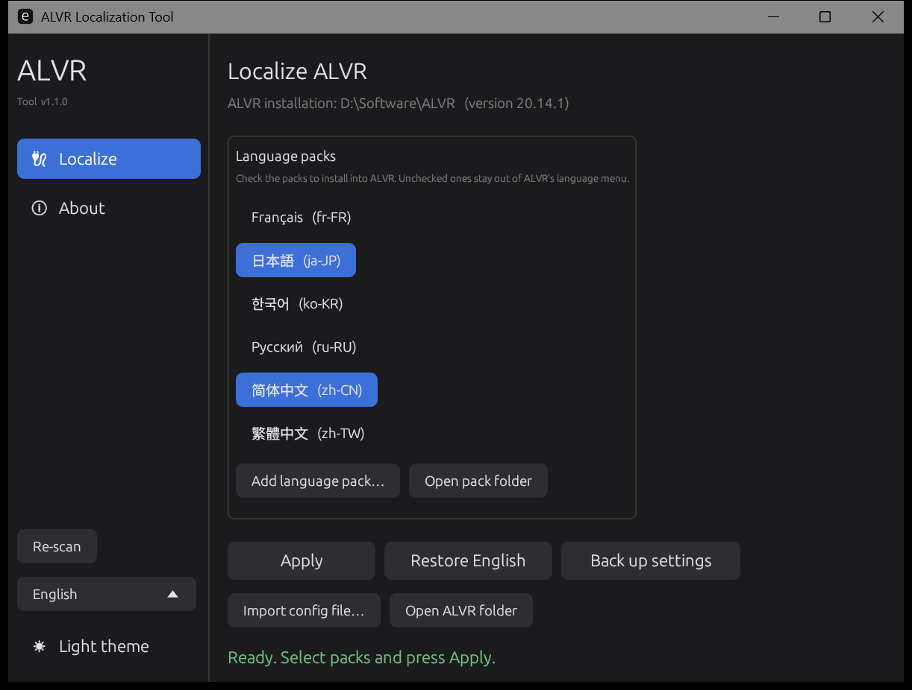
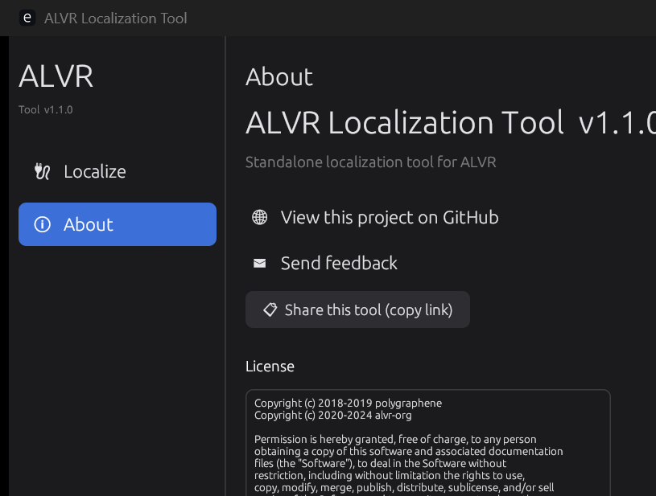
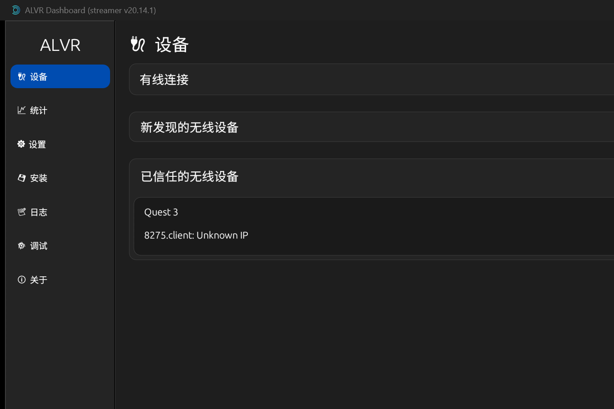

# ALVR-L10N


A standalone localization tool for [ALVR](https://github.com/alvr-org/ALVR) — the PC VR streaming app.

ALVR itself ships with an English-only UI. This tool adds **Chinese (Simplified / Traditional), Japanese and Korean** to it, keeps a per-version build of the localized app, and can be removed at any time to get the official build back.





## Features

* **Nothing global is changed.** ALVR is portable — the tool only writes inside your ALVR folder.
* **Two working modes**
  * **Full build** — a fully localized `ALVR Dashboard.exe` / `ALVR Launcher.exe` built from that ALVR release. 100% coverage, includes an in-app language selector.
  * **Compatibility mode** — for ALVR versions without a bundled build: translates strings and swaps the embedded font directly in the official executable. Partial coverage, no rebuild required.
* **Pick what gets installed.** Only the language packs you tick are copied into `ALVR/languages`, so ALVR's own language menu lists exactly those.
* **Own UI language.** The tool starts in English and can be switched to 简体中文 / 繁體中文 / 日本語 / 한국어; the choice is remembered in `tool.ini`.
* **Add your own pack** — `Add language pack…` takes a `.ini` (plus an optional `.ttf`), so the community can ship new languages without touching the binary.
* **Import a config** — drop in someone else's `session.json` after validation, with an automatic backup of the current one.
* **Safe by construction** — see [Safety](#safety).

## Download

Grab the latest `ALVR-L10N-win64.zip` from the releases page and unpack it anywhere. The zip already contains the four language packs and the v20.14.1 localized build.

## Language packs

| Pack | Language | Coverage |
| --- | --- | --- |
| zh-CN | 简体中文 | complete |
| zh-TW | 繁體中文 | complete |
| ja-JP | 日本語 | complete |
| ko-KR | 한국어 | complete |
| 
u-RU | Русский | partial (falls back to English) |
| r-FR | Français | partial (falls back to English) |

Untranslated entries show the English text, so a partial pack is always safe to
select. Adding strings is a plain text edit — see [Language pack format](#language-pack-format).

## Interface

* Left navigation like ALVR itself, with **Localize** and **About** pages
* ALVR-style rounded buttons, dark and light themes (toggle at the bottom left, remembered in 	ool.ini)
* Native rounded window corners and dark title bar on Windows 11
* About page: project link, feedback e-mail, "share this tool" (copies the repository link) and the full license

## Usage

1. Start ALVR once (so it creates `session.json`), then close it.
2. Run `ALVR-L10N.exe`.
3. Tick the language packs you want.
4. Press **Apply**.
5. Open ALVR — the interface is localized, and the language can be switched later from the tab bar in ALVR's **Settings** page.

**Restore English**: press `Restore English`. The original executables are copied back from `.alvr-l10n/`.

### Command line

```
ALVR-L10N.exe --apply [--lang zh-CN,ja-JP] [--no-build] [--no-font] [--no-strings] [--path <ALVR dir>]
ALVR-L10N.exe --restore
ALVR-L10N.exe --backup-settings
```

Output is written to `alvr-l10n.log` next to the executable.

## Safety

| Risk | Mitigation |
| --- | --- |
| A patched binary that does not start | After patching, the tool launches the app once; if it crashes, the official build is restored automatically. |
| Settings reset | `session.json` is copied to `<ALVR>/配置备份/` before anything is written, and restored if ALVR rewrote it. |
| Replacing internal values | ALVR stores enum names (e.g. `High`) inside `session.json`; `languages/deny.txt` lists values that must never be replaced, plus a heuristic that only touches prose. |
| Clutter in the ALVR folder | Executable backups live in one hidden folder `.alvr-l10n/`; settings backups live in `配置备份/`. |
| Uninstalling | `Restore English`, then delete `.alvr-l10n/`, `配置备份/`, `language.ini` and `languages/`. |

## How it works

**Full build (100%)**

A fork of ALVR adds a tiny `alvr-i18n` crate that reads `language.ini` and `languages/*.ini`, plus a hook in the GUI text layout that translates every rendered string. The localized binaries for each ALVR release are built once and stored in `builds/<version>/`.

**Compatibility mode (partial)**

The official executable is patched in place:

* English string literals are replaced by translations, **space-padded** so the file length never changes. Only entries whose UTF-8 length fits the original are used, which is why short labels often stay English.
* The embedded `Ubuntu Light` font (used by ALVR's UI) is replaced by a CJK subset that fits into the same slot, so Chinese/Japanese/Korean glyphs render.
* Anything that looks like an enum value or an internal identifier is skipped (`looks_like_ui_text` + `deny.txt`).

**Supported layouts**

| Layout | Example |
| --- | --- |
| Launcher-managed | `<ALVR>\installations\v20.14.1\ALVR Dashboard.exe` |
| Portable / zip | `<ALVR>\ALVR Dashboard.exe` |

The version is read from the executable's version resource, so `builds/v20.14.1` and `builds/20.14.1` both match.

## Language pack format

`languages/<id>.ini`:

```ini
[meta]
name = 简体中文            ; native name shown in the tool
[strings]
Settings = 设置            ; English source text = translation
[prefixes]
Tip: = 提示：
```

* Keys are matched against the English text ALVR renders.
* `[prefixes]` entries apply to every string starting with that prefix (useful for long help texts).
* Escapes `\n`, `\t` and `\\` are supported.
* A pack may ship `<id>.ttf`; compatibility mode injects it into ALVR's font slot (it must be small enough — roughly 350 KB, see `tools/`).

To propose a new language: add `languages/<id>.ini` and open a pull request. The tool lists every `.ini` in that folder.

## Build from source

```powershell
cargo build --release      # produces target/release/ALVR-L10N.exe
```

Requirements: Rust stable and the MSVC toolchain on Windows. The UI fonts in `assets/` are pre-built subsets; `tools/build_ui_font.py` regenerates them (needs `fonttools`).

Localized builds live in `builds/<version>/`; the scripts used to produce them from an ALVR release are in `tools/`.

## Credits

* [ALVR](https://github.com/alvr-org/ALVR) — MIT.
* [Noto Sans](https://fonts.google.com/noto) (SC/KR) — SIL Open Font License 1.1; the embedded subsets are OFL as well.

## License

MIT — see [LICENSE](LICENSE).

## 中文说明

ALVR 官方界面只有英文。这个工具给它加上简体中文 / 繁体中文 / 日语 / 韩语，并且可以随时还原成官方英文版。

* **只有你勾选的语言包会装进 ALVR**，ALVR 的语言菜单里就只出现这些；
* 工具界面默认英文，可切换到中文/日文/韩文；
* 「扩展语言包…」可以加载别人做的 `.ini` 语言包；
* 「导入配置文件…」可以导入别人给的 `session.json`（会先校验、先备份）；
* 每次改动前都会自动备份 `session.json` 到 `ALVR\配置备份\`，程序启动不了会自动还原。

用法：启动一次 ALVR → 关掉 → 打开本工具 → 勾语言 → 点「应用」。
