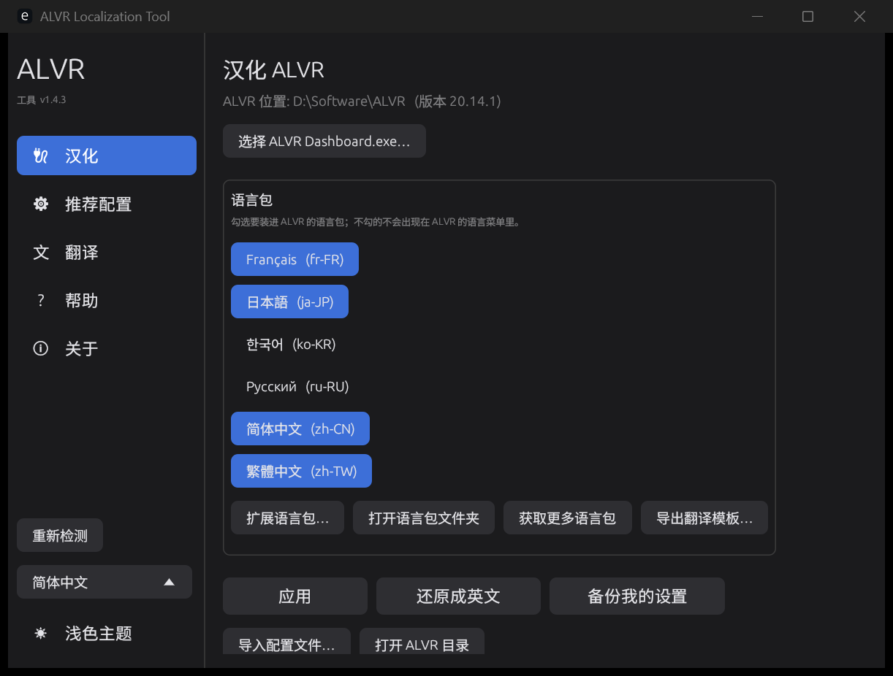
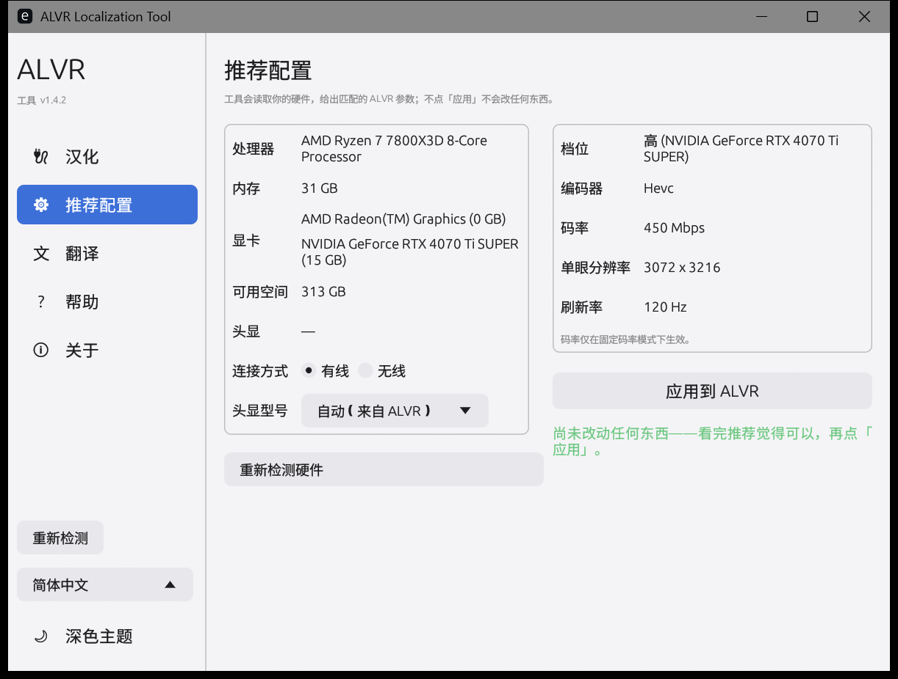

# ALVR-L10N

A small Windows tool that gives a normal [ALVR](https://github.com/alvr-org/ALVR) installation a
Chinese interface, plus Japanese, Korean, Russian and French. It runs next to ALVR, not inside it.
Nothing here is proposed to the ALVR project, and this is not a fork of it.



## What it does

- Copies language packs into `ALVR/languages` and tells ALVR which one to use, so the language
  picker inside ALVR's Settings tab lists the languages you installed and nothing else.
- Ships a localized build of `ALVR Dashboard.exe` for the ALVR versions under `builds/`. For
  v20.14.1 the whole interface, including every settings entry, is translated.
- Reads CPU, GPU, VRAM and RAM and suggests codec, bitrate, resolution and refresh rate. It writes
  those values into `session.json` only when you press Apply.
- Can generate a new language pack from your own OpenAI-compatible endpoint (OpenAI, DeepSeek,
  Moonshot, GLM, SiliconFlow, a local Ollama). It is a shortcut for people who want a language that
  is not shipped here; editing a `.ini` by hand still works.



## Usage

1. Start ALVR once so it writes `session.json`, then close it.
2. Run `ALVR-L10N.exe`.
3. Tick the languages you want and press Apply.
4. Start ALVR. If a translated build was installed, a language picker appears in the Settings tab.

Restore English copies the original executables back from `.alvr-l10n/`. Settings are copied to
`配置备份/` before anything is written.

Command line:

```
ALVR-L10N.exe --apply [--lang zh-CN,ja-JP] [--path <ALVR folder>]
ALVR-L10N.exe --apply --in-place          # patch the official exe instead of working on a copy
ALVR-L10N.exe --restore
ALVR-L10N.exe --backup-settings
```

## Two modes, and why the second one is limited

**Translated build.** A local ALVR fork adds an `alvr-i18n` crate and a hook in the text layout, so
every string ALVR renders goes through a lookup table. That is why the translated build covers the
whole interface. It has to be built once per ALVR release; `builds/<version>` holds those builds.

**Compatibility mode.** When there is no build for your ALVR version, the tool patches the official
executable instead. It is a workaround, and the costs are worth stating plainly:

- A replacement has to fit the original byte count, so only short strings can be translated. On
  v20.14.1, 152 of the known strings are too long and stay English. On an unreleased nightly almost
  nothing matches: the last run applied 3 strings.
- Rewriting byte sequences inside another `.exe` is something malware does too. Antivirus software
  may quarantine the result. Use the translated build when one exists.
- Every new ALVR version means new work. For nightly builds it is usually not worth it.

**Compatibility mode never touches the original folder.** It copies ALVR to a sibling directory
(`ALVR-L10N-<version>`), patches the copy, and prints where it went. Pass `--in-place` if you really
want the official folder modified.

## Language packs

`languages/<id>.ini` is a plain text file:

```
[meta]
id = zh-CN
name = 简体中文

[strings]
Settings = 设置
Resolution = 分辨率
```

Missing entries fall back to English, so a partial pack is safe. `languages/deny.txt` lists values
that must never be replaced, because ALVR stores some of them inside `session.json`.

The Chinese, Japanese and Korean packs were written with AI assistance and have not been checked by
native speakers; the Russian and French packs are partial for the same reason. Corrections are the
most useful help this project can get: edit the `.ini` and open a pull request.

## Building

```
cd app
cargo build --release
```

Needs an MSVC toolchain and the vendored crates used here. `tools/rebuild.ps1` wraps the same
command. The font subsets in `assets/` are generated by the Python scripts in `tools/` and must be
regenerated after adding UI strings, otherwise new characters render as empty boxes.

## License

MIT. ALVR is MIT as well; see `THIRD_PARTY_LICENSES.md`. Not affiliated with the ALVR project.

---

## 中文说明

给普通安装的 ALVR 加中文界面的小工具，顺带支持日、韩、俄、法。它不改 ALVR 源码，也不是它的分支。

- 有对应版本的翻译版时，整个界面（含所有设置项）都是中文；没有对应版本时会**复制一份到旁边的
  `ALVR-L10N-<版本>` 目录**再处理，原目录不会被改动。
- 补丁模式只是兜底：只能翻原文足够长的字符串，杀软也可能误报。能用翻译版就用翻译版。
- 翻译有错欢迎直接改 `languages/*.ini` 提 PR，这是最需要的帮助。
